# Movie Time — เวลาดูหนัง

> ฮับกลางของ vault นี้ ดูว่าจะดูอะไรดี แล้วตามลิงก์ `[[...]]` ไป
> เปิด Graph view ใน Obsidian จะเห็นหนัง อนิเมชัน อารมณ์ และสถานะโยงกัน

## ภาพรวม

```mermaid
graph TD
    hub["Movie Time — เวลาดูหนัง"] --> movies["Movies — หนัง"]
    hub --> animation["Animation — อนิเมชัน"]
    hub --> watchlist["Watchlist — อยากดู"]
    hub --> watched["Watched — ดูแล้ว"]
    hub --> favorites["Favorites — ชอบมาก"]
    movies --> feelgood["Feel-Good — เบาสมอง"]
    animation --> feelgood
    movies --> drama["Drama — ดราม่า"]
    movies --> action["Action — แอ็กชัน"]
    movies --> romance["Romance-Comedy — โรแมนติก / คอมเมดี้"]
    movies --> thriller["Thriller-Horror — ระทึกขวัญ / สยองขวัญ"]
    movies --> scifi["SciFi-Fantasy — ไซไฟ / แฟนตาซี"]
    movies --> family["Family-Warm — ครอบครัว / อบอุ่น"]
    movies --> documentary["Documentary — สารคดี / เรื่องจริง"]
    animation --> scifi
    animation --> family
    animation --> romance
    animation --> action
    watchlist --> scott["Scott Pilgrim Takes Off"]
    watched --> shawshank["The Shawshank Redemption"]
    watched --> spirited["Spirited Away"]
    favorites --> shawshank
    favorites --> spirited
```

## ดูอะไรดีตอนนี้

- อยากดูเรื่องต่อไป: [[Scott-Pilgrim-Takes-Off]] — อนิเมชัน 8 ตอน มีพากย์ไทยบน Netflix
- ถ้าอยากดูซ้ำเรื่องที่ชอบ: [[Favorites]]

## แยกตามประเภท

- [[Movies]] — หนัง live-action | [[Animation]] — อนิเมชัน

## แยกตามอารมณ์

- [[Feel-Good]] — เบาสมอง ดูแล้วสบายใจ
- [[Drama]] — ดราม่า ซึ้ง ให้กำลังใจ
- [[Action]] — แอ็กชัน มันส์ ลุ้น
- [[Romance-Comedy]] — โรแมนติก คอมเมดี้
- [[Thriller-Horror]] — ระทึกขวัญ สยองขวัญ
- [[SciFi-Fantasy]] — ไซไฟ แฟนตาซี โลกเหนือจริง
- [[Family-Warm]] — ครอบครัว อบอุ่นหัวใจ
- [[Documentary]] — สารคดี เรื่องจริง

## สถานะ

- [[Watchlist]] — อยากดู | [[Watched]] — ดูแล้ว | [[Favorites]] — ชอบมาก

เพิ่มเรื่องใหม่ด้วย [[Template-Movie]] (หนัง) หรือ [[Template-Animation]] (อนิเมชัน)
